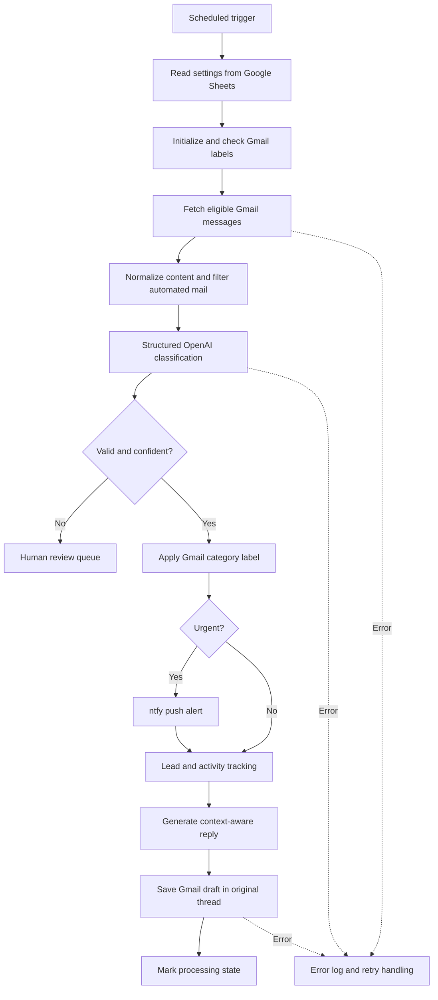

# AI-Powered Email Triage & Intelligent Reply Drafting

**An n8n-based shared-inbox assistant that classifies Gmail messages, highlights urgent work, tracks leads, and prepares replies for human review—without automatically sending email.**

**Project type:** Independent engineering portfolio project  
**Stack:** n8n · Gmail API · OpenAI · Google Sheets · JavaScript · ntfy  
**Operating model:** Scheduled inbox checks (10-minute interval in the documented design) · Six classification categories · Draft-only outbound replies

## Project links

- **Video walkthrough:** [Watch the demo on YouTube (unlisted)](https://youtu.be/KkgMf7npyLo)
- **LinkedIn:** [Professional profile](https://www.linkedin.com/in/usmantariqdev/) · [Project entries](https://www.linkedin.com/in/usmantariqdev/details/projects/)
- **Contact:** [usmantariq4799@gmail.com](mailto:usmantariq4799@gmail.com)

## The problem

A shared inbox mixes new business inquiries, customer conversations, support issues, unsolicited pitches, and automated messages. Reviewing everything manually makes it easy to miss an urgent request, lose track of a potential lead, or draft a response without the right context.

The goal was not to let an AI agent answer customers on its own. It was to automate the repetitive **triage and preparation**, while keeping a person responsible for sensitive decisions and every outbound reply.

## What I built

I designed and implemented **Mailroom**, a coordinated n8n workflow that:

1. Reads configurable rules and processing limits from Google Sheets.
2. Retrieves eligible Gmail messages, normalizes their contents, and filters automated noise.
3. Uses OpenAI to classify messages, detect urgency, summarize the request, and extract relevant lead information.
4. Applies Gmail labels and sends push notifications for urgent messages.
5. Updates a lead ledger or sends ambiguous cases to a human-review queue.
6. Creates a context-aware **draft in the original Gmail thread**, ready for a person to inspect and send.

An independent error path records exceptions and supports retry or escalation without requiring the entire inbox run to stop.

## Architecture

*Conceptual workflow diagram: it describes the processing stages and safeguards, not a node-for-node export.*

## Processing stages

| Stage | Responsibility | Engineering detail |
| --- | --- | --- |
| **00 — Configuration** | Load settings and prepare Gmail labels | Rules, urgency settings, reply tone, enabled/disabled controls, and processing limits are configurable in Sheets. |
| **01 — Inbox intake** | Fetch and clean eligible messages | Decode plain-text/HTML content, strip quoted replies, collapse duplicate thread work, and skip bounces or automated replies. |
| **02 — AI classification** | Produce structured triage data | Validate category, urgency, summary, confidence, and extracted details rather than trusting free-form model output. |
| **03 — Labels and alerts** | Organize and surface important messages | Apply Gmail labels and send ntfy alerts with relevant message context and a Gmail link when urgency rules match. |
| **04 — Lead and review records** | Preserve business context | Upsert leads by email, update activity without overwriting established lead status, and queue uncertain cases for review. |
| **05 — Draft and completion** | Prepare a response safely | Create a category-aware reply draft in the existing Gmail thread and record processing state. |
| **Error lane** | Handle exceptions | Log failures, allow recoverable retries, and alert on repeated failures while the wider run continues. |

## Classification model

The workflow organizes eligible messages into six operational categories:

| Category | Intended handling |
| --- | --- |
| `lead` | Capture or update a potential customer's details and prepare a relevant draft. |
| `existing_customer` | Preserve customer context and route appropriately. |
| `support` | Identify the issue and urgency; prepare a support-oriented draft. |
| `marketing_pitch` | Separate unsolicited commercial outreach from customer work. |
| `spam` | Reduce noise without triggering an unnecessary customer response. |
| `needs_review` | Escalate unclear, mixed, low-confidence, or sensitive messages to a person. |

The AI output is **validated before actions are taken**. A confident-sounding answer is not enough: unexpected structured output or uncertain classification is handled as a review case.

## Engineering decisions

### 1. Draft-only is a deliberate safety boundary

The system **never automatically sends a generated reply**. Gmail drafts remain in their original conversation threads so a person can verify facts, adjust tone, and choose whether to send. This is especially important for complaints, sensitive requests, or cases where the AI has incomplete context.

### 2. Treat repeated inbox scans as normal

A scheduled workflow may encounter the same message multiple times. Message IDs and Gmail processing labels—including **Done**, **Drafted**, and **Alerted**—help limit duplicate drafts, notifications, and repeated work.

### 3. Normalize the email before asking the model

Real emails contain signatures, quoted threads, HTML, automated footers, and forwarded text. Cleaning the message first makes classification more focused and helps avoid mistaking an old quoted request for a new one.

### 4. Keep the lead record stable

Google Sheets acts as a lightweight lead ledger. Matching by sender email allows a new interaction to update the activity history without casually resetting an existing lead's business status.

### 5. Make operating rules editable without rebuilding the workflow

The configuration sheet controls classification guidance, urgency behavior, alert preferences, reply tone, and processing limits. This separates business policy from n8n wiring.

### 6. Fail visibly, not silently

Processing errors are recorded in an Error Log. Recoverable cases can be retried, and repeated failures are surfaced for attention rather than silently disappearing from the inbox pipeline.

## Example message journey

**Incoming email:** “The export keeps failing. We need it for a meeting today.”

1. The intake stage extracts the latest request from the email thread.
2. Classification identifies **support** and an **urgent** signal.
3. Gmail receives the relevant category label.
4. An ntfy notification summarizes the issue and links back to the message.
5. The workflow prepares a reply draft in the same Gmail thread.
6. A person reviews the draft and decides what to send.

*This is an illustrative scenario from the project case study, not a claim about a real customer's email.*

## What the system produces

- **Organized inbox:** Category labels for new leads, customers, support, pitches, spam, and human review.
- **Urgency visibility:** Push notifications with the reason for escalation and a link to the message.
- **Lead ledger:** A record of contacts, their needs, and subsequent activity.
- **Human-review queue:** A place for uncertain or sensitive cases to be resolved deliberately.
- **Review-ready Gmail drafts:** Responses prepared in the original thread, never sent automatically.
- **Processing and error records:** State labels and exception logging for debugging and follow-up.

## Testing and evidence

The engineering case study documents the workflow's control points: structured AI-output validation, confidence-based review, duplicate-action prevention, lead-state preservation, configurable rules, and an error/retry lane. The linked video demonstrates the workflow.

I have **not** attached an invented accuracy rate, time-savings percentage, or production SLA. The documented 10-minute schedule describes the intended polling interval; it is not a latency guarantee.

## Repository scope

This repository documents the architecture, workflow behavior, and engineering decisions. It is **not presented as a public deployment or a complete runnable source release**. A working setup would require Gmail, OpenAI, Google Sheets, and ntfy configuration plus authorized credentials. Private tokens, email contents, and user data should not be committed to GitHub.

## Author

**Usman Tariq** — AI Automation Engineer  
[LinkedIn](https://www.linkedin.com/in/usmantariqdev/) · [LinkedIn Projects](https://www.linkedin.com/in/usmantariqdev/details/projects/) · [Email](mailto:usmantariq4799@gmail.com)
